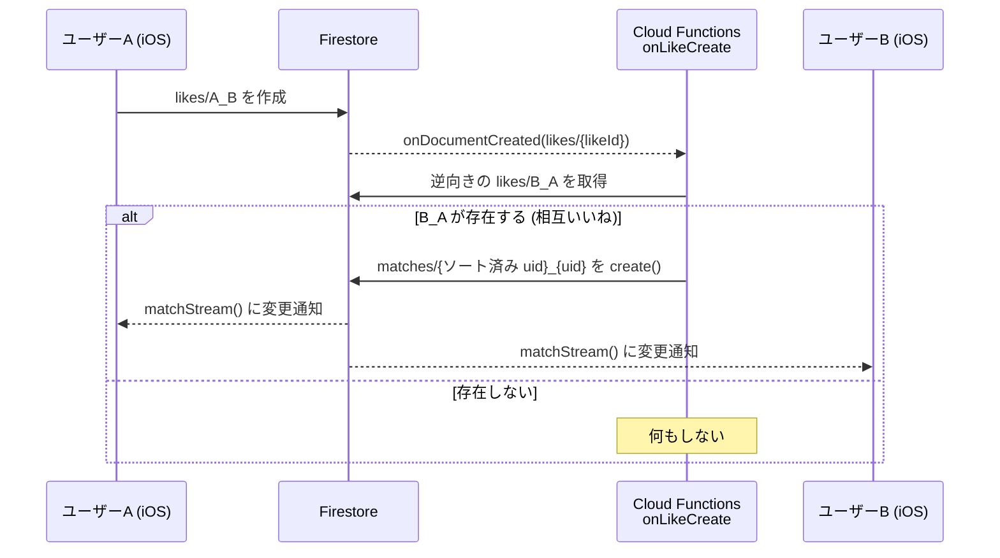

# HobbyMatch

趣味でつながる友達を探す iOS アプリです。プロフィールに趣味を登録して他のユーザーを眺め、お互いに「いいね」を送り合うとマッチが成立します。

Firebase（Authentication / Cloud Firestore / Security Rules / Cloud Functions）を学ぶためのプロジェクトです。そのため、Firestore と Security Rules の扱いに集中し、それ以外は最小限の実装にしています。チャット機能は作りません。

---

## 目次

- [機能](#機能)
- [技術スタック](#技術スタック)
- [アーキテクチャ](#アーキテクチャ)
- [データモデル (Firestore)](#データモデル-firestore)
- [マッチ成立の仕組み](#マッチ成立の仕組み)
- [開発環境の構成 (Debug / Release)](#開発環境の構成-debug--release)
- [セットアップ](#セットアップ)
- [1人でマッチを試す](#1人でマッチを試す)
- [本番環境へのデプロイ](#本番環境へのデプロイ)
- [ハマりどころ](#ハマりどころ)
- [今後の予定](#今後の予定)

---

## 機能

### ユーザーの流れ

```
ログイン (Google) ─→ プロフィール作成 (初回のみ) ─→ タブ画面
                                                   ├─ 友達を探す → プロフィール詳細 → いいね
                                                   ├─ アカウント → 自分のプロフィール / ログアウト
                                                   └─ マッチ    → マッチした相手の一覧
```

### 画面と機能

| 画面 | 内容 |
| --- | --- |
| ログイン | Google アカウントでサインインします（Firebase Auth + Google Sign-In）。 |
| プロフィール作成 | ログイン後にプロフィールが未作成なら、この画面が強制的に表示されます。表示名（Google アカウント名が初期値）、自己紹介、趣味（カンマ区切りで入力）を登録します。アイコンは Google アカウントの写真を使います。 |
| 友達を探す | 自分以外の全ユーザーの一覧です。Firestore のスナップショットリスナーで購読しているため、新しいユーザーが登録されると自動で反映されます。 |
| プロフィール詳細 | 相手のアイコン、表示名、自己紹介、趣味タグを表示します。ハートボタンでいいねを送れます。いいねは**取り消せません**。 |
| マッチ | 相互いいねが成立した相手の一覧です。リアルタイムに更新され、タップすると詳細画面に移動します。 |
| アカウント | 自分のプロフィールの表示とログアウトができます。 |

### 入力の制約

クライアント側のバリデーションと Security Rules の両方でチェックしています。

| 項目 | 制約 |
| --- | --- |
| 表示名 | 必須、1〜50 文字 |
| 自己紹介 | 300 文字以内 |
| 趣味 | 10 個まで |

---

## 技術スタック

| 分類 | 使用技術 |
| --- | --- |
| iOS | Swift 6 / SwiftUI / Observation（`@Observable`）/ Swift Concurrency |
| 最低対応 OS | iOS 26.4 |
| パッケージ管理 | Swift Package Manager |
| 認証 | Firebase Authentication + GoogleSignIn-iOS 9.x |
| DB | Cloud Firestore（firebase-ios-sdk 12.x） |
| サーバー処理 | Cloud Functions for Firebase（2nd gen）/ TypeScript / Node.js 24 |
| ローカル開発 | Firebase Local Emulator Suite（Firestore + Functions） |

---

## アーキテクチャ

### ディレクトリ構成

```
hobbymatch/
├── Hobbymatch/                     # iOS アプリ本体
│   ├── hobbymatchApp.swift         # エントリポイント。Firebase 初期化、エミュレータ接続、ログイン状態による画面切り替え
│   ├── Domain/                     # エンティティ (AuthUser / UserProfile / Like / Match)
│   ├── Data/                       # Firebase へのアクセス層 (Service + Protocol)
│   │   ├── Login/                  #   AuthService        : Google Sign-In / Firebase Auth
│   │   ├── Profile/                #   UserProfileService : user_profiles コレクション
│   │   ├── Like/                   #   LikeService        : likes コレクション
│   │   └── Match/                  #   MatchService       : matches コレクション
│   ├── Presentation/               # SwiftUI の View と ViewModel
│   │   ├── Login/                  #   LoginView / SessionViewModel (アプリ全体のセッション状態)
│   │   ├── ProfileEdit/            #   プロフィール作成
│   │   ├── Main/                   #   タブ
│   │   ├── ProfileList/            #   友達を探す
│   │   ├── ProfileDetail/          #   プロフィール詳細 + いいねボタン
│   │   ├── MatchListView/          #   マッチ一覧
│   │   ├── AccountView/            #   自分のアカウント
│   │   └── Component(s)/           #   共通コンポーネント (プロフィール表示 / ユーザー一覧)
│   ├── GoogleService-Info.plist    # ※ git 管理外 (後述)
│   └── Info.plist                  # ※ git 管理外 (後述)
├── functions/                      # Cloud Functions (TypeScript)
│   └── src/index.ts                #   onLikeCreate: 相互いいねを判定してマッチを作成
├── firebase.json                   # Firebase CLI の設定 (Firestore / Functions / Emulator)
├── .firebaserc                     # 使用する Firebase プロジェクト
├── firestore.rules                 # Security Rules
└── firestore.indexes.json          # Firestore インデックス定義
```

### レイヤー構成

**Presentation / Domain / Data** の 3 層です。

- **Domain**：アプリで扱う型です。Firebase の `User` を View や ViewModel に渡さないよう、ログイン情報（`AuthUser`）と Firestore 上のプロフィール（`UserProfile`）を別の型にしています。
- **Data**：Firestore と Auth にアクセスする Service です。どれも `XxxServiceProtocol` を実装しています。エラーは Service 内で握りつぶさずに `throw` し、ViewModel 側で処理します。
- **Presentation**：画面ごとの View と ViewModel です。ViewModel は `@MainActor @Observable` で、Service は `init(service: any XxxServiceProtocol = XxxService())` の形で注入します（テストでモックに差し替えるため）。

### 主な設計

- **セッション状態は `SessionViewModel` で一元管理**しています。認証状態と自分のプロフィールの有無を、次の 4 状態の enum にまとめています。ルート画面（`AppNavigation`）はこの状態で表示を切り替えます。

  | 状態 | 表示する画面 |
  | --- | --- |
  | `.loading` | ProgressView |
  | `.unauthorized` | LoginView |
  | `.authorizedWithoutProfile(AuthUser)` | ProfileEditView（プロフィール作成を強制） |
  | `.authorized(AuthUser, UserProfile)` | MainView（タブ） |

- **リアルタイム購読は `AsyncStream` でラップ**しています。Firebase のコールバック API（`addStateDidChangeListener` / `addSnapshotListener`）を `AsyncStream` / `AsyncThrowingStream` に変換し、ViewModel は `for await` で受け取ります。ストリームが終了したときはリスナーを解除します。
- **タイムスタンプはサーバー時刻**です。`@ServerTimestamp` を使い、クライアントの時計に依存しません。
- **ドキュメント ID**：`user_profiles` の ID は Auth の uid です。`likes` と `matches` の ID は、uid から一意に決まる値にして重複を防いでいます（後述）。

---

## データモデル (Firestore)

### コレクション

#### `user_profiles/{uid}`

| フィールド | 型 | 説明 |
| --- | --- | --- |
| `displayName` | string | 表示名（1〜50 文字） |
| `bio` | string | 自己紹介（300 文字以内） |
| `hobbies` | array\<string\> | 趣味（10 個まで） |
| `photoURL` | string? | アイコン画像の URL（Google アカウントの写真） |
| `createdAt` | timestamp | 作成日時（サーバー時刻） |
| `updatedAt` | timestamp | 更新日時（サーバー時刻） |

#### `likes/{fromUserId}_{toUserId}`

| フィールド | 型 | 説明 |
| --- | --- | --- |
| `fromUserId` | string | いいねした人の uid |
| `toUserId` | string | いいねされた人の uid |
| `createdAt` | timestamp | 作成日時 |

ドキュメント ID を `送信者_受信者` に固定しているので、同じ相手に 2 回いいねしても 1 件のままです。

#### `matches/{uidA}_{uidB}`

| フィールド | 型 | 説明 |
| --- | --- | --- |
| `users` | array\<string\> | マッチした 2 人の uid（ソート済み） |
| `createdAt` | timestamp | マッチ成立日時 |

ID は 2 人の uid をソートして `_` でつないだものです。A→B と B→A のどちらの順でいいねしても同じ ID になります。

### Security Rules の概要

詳細は [firestore.rules](../firestore.rules) を参照してください。

| コレクション | read | create | update | delete |
| --- | --- | --- | --- | --- |
| `user_profiles` | ログイン済みなら誰でも | 本人のみ（スキーマ検証あり） | 本人のみ（スキーマ検証あり） | 不可 |
| `likes` | 送信者か受信者のみ。存在しないドキュメントの read も許可（いいね済みかを調べるため） | 送信者が自分であること、自分宛てでないこと、ID の形式、相手のプロフィールが存在することを検証 | 不可 | 不可（いいねは取り消せない） |
| `matches` | `users` に自分が含まれる場合のみ | 不可 | 不可 | 不可 |

`matches` はクライアントから一切書き込めません。Cloud Functions が Admin SDK で書き込みます（Admin SDK は Rules を無視します）。

---

## マッチ成立の仕組み

マッチの判定はクライアントでは行わず、Cloud Functions の Firestore トリガー（`onLikeCreate`、[functions/src/index.ts](../functions/src/index.ts)）で行います。



- 関数のリージョンは `asia-northeast1` です。
- **冪等性**：`create()` は既にドキュメントがあると失敗します。2 人がほぼ同時にいいねして関数が 2 回動いても、2 回目は例外を握りつぶすだけで重複は作られません。
- `matches` には uid だけを保存し、表示名などは持たせていません。マッチ一覧の画面で、相手の `user_profiles` を個別に取得して表示します（ViewModel 内でキャッシュしています）。

---

## 開発環境の構成 (Debug / Release)

Debug ビルドでは、**Auth だけ本番を使い、Firestore と Functions はローカルのエミュレータ**に接続します。

| | Auth | Firestore | Functions |
| --- | --- | --- | --- |
| Debug ビルド | 本番 | エミュレータ（`127.0.0.1:8080`） | エミュレータ |
| Release ビルド | 本番 | 本番 | 本番 |

**Auth Emulator を使わない理由**：Auth Emulator では Google Sign-In が使えません（本物の Google OAuth サーバーに接続できないため）。そこで、ログインは本番 Auth で行い、データの読み書きはエミュレータで行う構成にしています。

エミュレータへの接続は [hobbymatchApp.swift](../Hobbymatch/hobbymatchApp.swift) の `#if DEBUG` ブロックで設定しています。

```swift
#if DEBUG
let settings = Firestore.firestore().settings
settings.host = "127.0.0.1:8080"
settings.isSSLEnabled = false
settings.cacheSettings = MemoryCacheSettings()  // オフライン永続化を無効化
Firestore.firestore().settings = settings
#endif
```

> **注意**
> - **Debug ビルドはエミュレータが起動していないと動きません。** プロフィールの取得が失敗し、ログアウトされます。
> - 接続先が `127.0.0.1` なので、Debug ビルドが動くのは **シミュレーターだけ**です。実機で試す場合は、`settings.host` を Mac の LAN 内 IP に変え、`firebase.json` のエミュレータ設定に `"host": "0.0.0.0"` を追加してください。

---

## セットアップ

### 前提ツール

| ツール | バージョン | 確認コマンド |
| --- | --- | --- |
| Xcode | 26.4 以上（iOS 26.4 SDK） | `xcodebuild -version` |
| Node.js | 24（`functions/package.json` の `engines`） | `node -v` |
| Java | 21 以上（Firestore エミュレータは JVM で動きます） | `java -version` |
| Firebase CLI | 最新 | `firebase --version` |

Firebase CLI のインストールとログイン：

```sh
npm install -g firebase-tools   # sudo は付けない (後述のハマりどころを参照)
firebase login
```

Java が入っていない場合：

```sh
brew install openjdk@21
```

### 1. Firebase プロジェクトの準備

既存のプロジェクト（`.firebaserc` の `test-fmating-app-11`）にアクセスできる場合は、この手順を飛ばして「2.」に進んでください。自分の Firebase プロジェクトで動かす場合は、[Firebase Console](https://console.firebase.google.com/) で次の操作をします。

1. **プロジェクトを作成**します。
2. **Authentication** → ログイン方法で **Google** を有効にします。
3. **Firestore Database** → データベースを作成します。ロケーションは `firebase.json` に合わせて `asia-northeast2` にします。
4. **プロジェクトの設定** → iOS アプリを追加します。
   - バンドル ID：`com.0v0d.hobbymatch`（変える場合は Xcode の `PRODUCT_BUNDLE_IDENTIFIER` も変更）
   - ダウンロードした `GoogleService-Info.plist` は手順 2 で使います。
5. このリポジトリが使うプロジェクトを切り替えます。

   ```sh
   firebase use --add   # 作成したプロジェクトを選び、エイリアスを default にする
   ```

### 2. git 管理外のファイルを配置する

`.gitignore` で `*.plist` を除外しているため、次の 2 ファイルはクローンしただけでは存在しません。手動で配置してください。

#### `Hobbymatch/GoogleService-Info.plist`

Firebase Console からダウンロードしたファイルを `Hobbymatch/` に置きます。Xcode プロジェクトはフォルダ同期（Synchronized Group）になっているので、置くだけでターゲットに含まれます。

> `GoogleService-Info.plist` の `PROJECT_ID` と `.firebaserc` のプロジェクトを**必ず一致させてください**。エミュレータのデータはプロジェクト ID ごとに分かれるため、ずれているとアプリの書き込みで Functions が発火しません。

#### `Hobbymatch/Info.plist`

Google Sign-In の画面からアプリに戻るための URL スキームを登録するファイルです。`YOUR_REVERSED_CLIENT_ID` は、`GoogleService-Info.plist` の `REVERSED_CLIENT_ID` の値（`com.googleusercontent.apps.xxxx` の形式）に置き換えてください。

```xml
<?xml version="1.0" encoding="UTF-8"?>
<!DOCTYPE plist PUBLIC "-//Apple//DTD PLIST 1.0//EN" "http://www.apple.com/DTDs/PropertyList-1.0.dtd">
<plist version="1.0">
<dict>
	<key>CFBundleURLTypes</key>
	<array>
		<dict>
			<key>CFBundleTypeRole</key>
			<string>Editor</string>
			<key>CFBundleURLSchemes</key>
			<array>
				<string>YOUR_REVERSED_CLIENT_ID</string>
			</array>
		</dict>
	</array>
</dict>
</plist>
```

値は次のコマンドで確認できます。

```sh
/usr/libexec/PlistBuddy -c "Print :REVERSED_CLIENT_ID" Hobbymatch/GoogleService-Info.plist
```

### 3. Cloud Functions の依存関係をインストールしてビルドする

エミュレータが読み込むのは TypeScript をコンパイルした `functions/lib/index.js` です。起動前にビルドしてください。

```sh
cd functions
npm install
npm run build
cd ..
```

### 4. エミュレータを起動する

リポジトリのルート（`firebase.json` があるディレクトリ）で実行します。

```sh
firebase emulators:start --only firestore,functions
```

| サービス | URL |
| --- | --- |
| Emulator UI | http://127.0.0.1:4000 |
| Firestore | 127.0.0.1:8080 |
| Functions | 127.0.0.1:5001 |

- `firestore.rules` を編集すると、エミュレータが自動で再読み込みします。
- Functions を編集する場合は、別のターミナルで `npm --prefix functions run build:watch` を実行しておくと、保存するたびに再ビルドされてエミュレータにも反映されます。
- エミュレータのデータは終了すると消えます。残したい場合は次のように起動します（`emulator-data/` は `.gitignore` に追加してください）。

  ```sh
  firebase emulators:start --only firestore,functions --import=./emulator-data --export-on-exit
  ```

### 5. アプリを起動する

1. `Hobbymatch.xcodeproj` を Xcode で開きます。
2. Swift Package（firebase-ios-sdk / GoogleSignIn-iOS）の解決を待ちます。止まっている場合は **File → Packages → Resolve Package Versions** を実行してください。
3. スキーム `Hobbymatch` を選び、**シミュレーター**を実行先にして Run（⌘R）します。
4. 「ログイン」を押して Google アカウントでサインインし、プロフィールを作成します。

作成したプロフィールは、Emulator UI（http://127.0.0.1:4000/firestore）の `user_profiles` で確認できます。

---

## 1人でマッチを試す

マッチを試すには 2 つのアカウントが必要です。Emulator UI でダミーユーザーを作れば、1 人でも試せます（Emulator UI からの書き込みは管理者権限なので、Rules の制限を受けません）。

1. アプリでログインし、プロフィールを作成します。自分の uid は、Emulator UI の `user_profiles` のドキュメント ID で確認できます。
2. Emulator UI で `user_profiles/dummy` を作成します。

   | フィールド | 型 | 値 |
   | --- | --- | --- |
   | `displayName` | string | `ダミー` |
   | `bio` | string | `テスト用` |
   | `hobbies` | array | `["釣り"]` |

3. 同じく `likes/dummy_{自分のuid}` を作成します（ダミーから自分へのいいね）。

   | フィールド | 型 | 値 |
   | --- | --- | --- |
   | `fromUserId` | string | `dummy` |
   | `toUserId` | string | `{自分のuid}` |

4. アプリの「友達を探す」から「ダミー」を開き、ハートを押します。
5. `onLikeCreate` が動いて `matches/{uid}_dummy`（ソート順）が作られ、「マッチ」タブにダミーが表示されます。

関数の実行ログは、エミュレータを起動したターミナルか、Emulator UI の **Logs** タブで確認できます。

---

## 本番環境へのデプロイ

```sh
# Security Rules とインデックス
firebase deploy --only firestore:rules,firestore:indexes

# Cloud Functions (デプロイ前に lint と build が自動で実行される)
firebase deploy --only functions
```

> **本番デプロイ前に確認すること**
> - **Cloud Functions のデプロイには Blaze プラン（従量課金）が必要**です。
> - **複合インデックスが未定義です。** マッチ一覧のクエリ（`users` の `array-contains` と `createdAt` の降順）には複合インデックスが必要ですが、エミュレータはインデックスがなくても動くため、ローカルでは問題が表に出ません。本番で使う前に `firestore.indexes.json` に以下を追加してください。
>
>   ```json
>   {
>     "indexes": [
>       {
>         "collectionGroup": "matches",
>         "queryScope": "COLLECTION",
>         "fields": [
>           { "fieldPath": "users", "arrayConfig": "CONTAINS" },
>           { "fieldPath": "createdAt", "order": "DESCENDING" }
>         ]
>       }
>     ],
>     "fieldOverrides": []
>   }
>   ```
>
> - Firestore（`asia-northeast2`）と Functions（`asia-northeast1`）のリージョンが異なります。Firestore トリガーはリージョンの組み合わせに制約があるため、デプロイでエラーになった場合は `functions/src/index.ts` の `region` を Firestore と同じにしてください。

---

## ハマりどころ

| 症状 | 原因と対処 |
| --- | --- |
| `firebase emulators:start` が Java のエラーで起動しない | Firestore エミュレータは JVM で動くため、Java 21 以上が必要です。 |
| `npm install` が権限エラー（EACCES）で失敗する | `sudo npm install -g` を実行したせいで `~/.npm` が root の所有になっています。`sudo chown -R $(whoami) ~/.npm` で直ります。 |
| エミュレータに接続しているはずなのに SSL エラーになる | `useEmulator()` を呼んだ後に `settings` を再代入すると、SSL が有効に戻ります。現在のコードのように `settings.host` と `settings.isSSLEnabled = false` をまとめて設定し、代入は 1 回だけにしてください。 |
| Rules で拒否されるはずの書き込みが、一瞬成功したように見える | オフライン永続化が有効だと、`setData` はローカルキャッシュに書いた時点で成功を返し、Rules による拒否は後から反映されます。Debug ビルドでは `MemoryCacheSettings` にしています。UX のためにクライアント側でもバリデーションしています。 |
| `ListenerRegistration` が Sendable でないというコンパイルエラーが出る | Swift 6 の strict concurrency によるものです。`@preconcurrency import FirebaseFirestore` で回避しています。 |
| 各 Service の `xxxStream()` を共通のジェネリック関数にまとめたい | `@DocumentID` / `@ServerTimestamp` を使う型の Decodable 準拠が MainActor に隔離されるため、Sendable の要件とぶつかってうまくいきません。重複は受け入れて、Service ごとに書いています。 |
| Google ログイン後にアプリへ戻らない | `Info.plist` の URL スキームに `REVERSED_CLIENT_ID` が登録されていません（[手順 2](#2-git-管理外のファイルを配置する) を参照）。 |
| いいねしてもマッチが作られない | ① エミュレータを `functions` 込みで起動しているか ② `functions/lib` がビルド済みか ③ `GoogleService-Info.plist` と `.firebaserc` のプロジェクト ID が一致しているか、を確認してください。 |

---

## 今後の予定

- [x] Google ログイン
- [x] プロフィール作成・一覧（リアルタイム）
- [x] いいね（Rules による検証付き）
- [x] 相互いいねによるマッチ成立（Cloud Functions）
- [x] マッチ一覧
- [ ] マッチした相手の SNS アカウントの表示
- [ ] Security Rules の厳格化
- [ ] プロフィール編集画面（`UserProfileService.update` は実装済みで、UI がまだありません）
- チャット機能は作りません
